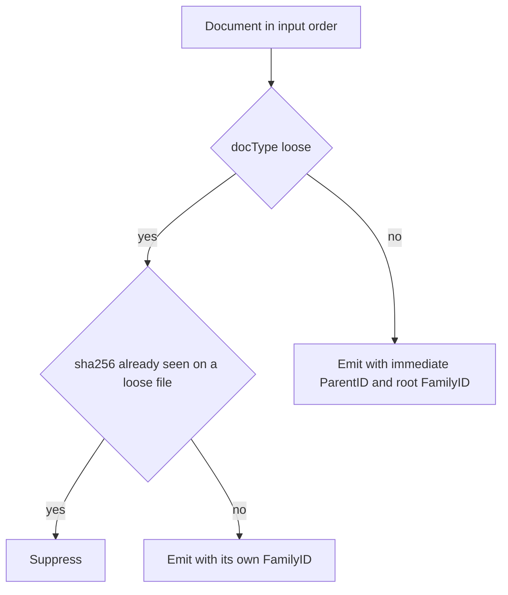

Translation. This is a faithful English translation of the implementation plan agreed in the conversation. It is not a separate plan. The original plan remains in the conversation, in Spanish.

# INGEST-4471: intact families

Local work only, on main at `c5ebbad`. There is no remote and there is no push. `.vscode/launch.json` and `.vscode/tasks.json` stay untracked and are not part of the commit. `data/current-tool-output.csv` stays as evidence of the previous failure.

## 1. Branch

From the repo root, with a clean tree except `.vscode/`:

```powershell
git switch -c ingest-4471-keep-family-attachments
```

`git switch -c` creates the branch and moves onto it. `main` is left as it is.

## 2. Behavior in `src/DedupTool/Deduper.cs`

Today one `HashSet` of `sha256` values suppresses any repeated document, and `FamilyID` is the immediate parent:

```22:40:src/DedupTool/Deduper.cs
        foreach (var d in batch.Documents)
        {
            if (!seen.Add(d.Sha256))
            {
                suppressed++;
                continue;
            }
            // ...
            if (d.ParentId != null)
            {
                var parent = byId[d.ParentId];
                familyId = parent.DocId;
                sentDate = parent.SentDate ?? "";
            }
```

New rule:

- A loose file whose `sha256` was already seen on another loose file is suppressed. The first one in the array wins. The loose-file hash set is not consulted for emails or attachments.
- Every email is emitted. Every attachment is emitted. In this pass there is no hash dedup for those types, including inside the same family.
- `ParentID` is the immediate `parentId`, or empty.
- `FamilyID` is the document reached by walking `parentId` up to the one with no parent. For a loose file it is the loose file itself.
- An attachment's `SentDate`, at any depth, is the root's original `SentDate`. It is not converted to UTC. A loose file still has an empty date.
- Row order follows the input order of the emitted documents, so the existing tests stay as they are.
- If the chain contains a cycle or a missing parent, the tool throws. The `byId` index is built as it is today.

On the sample batch the effect is: `DOC-000005`, `DOC-000010`, and `DOC-000011` come back; only `DOC-000013` stays suppressed. 16 documents in, 15 out, 1 suppressed.



## 3. Tests in `test/DedupTool.Tests/DeduperTests.cs`

The three existing tests are not modified.

- Load `data/batch-sample.json` by searching upward from the test directory. Assert that `DOC-000005` exists with `ParentID` and `FamilyID` `DOC-000004`, that `DOC-000003` remains, and that `DOC-000010` and `DOC-000011` stay tied to `DOC-000009`. Also assert that `DOC-000008` is present and `DOC-000013` is not, so loose-file dedup stays fixed.
- A synthetic nested case, with the repeated PDF placed before the grandchild: `EMAIL-1`, `ATT-MID` child of `EMAIL-1`, `ATT-LEAF` child of `ATT-MID`, and `EMAIL-2` with an attachment of the same hash as `ATT-LEAF`. Input order puts `EMAIL-2`'s attachment first. Assert all five rows; `ATT-MID` with parent and family `EMAIL-1`; `ATT-LEAF` with parent `ATT-MID`, family `EMAIL-1`, and `SentDate` equal to `EMAIL-1`'s original text.

## 4. Verification

From the repo root:

```powershell
dotnet test
```

Then a run of the ticket, and a manual check of those rows, without leaving the CSV in the repo:

```powershell
dotnet run --project src/DedupTool -- data/batch-sample.json $env:TEMP\ingest-4471-out.csv
```

Check `DOC-000005` and delete that CSV. Do not install packages. Record the actual command and result.

## 5. `DECISIONS.md`, entirely in English

The file is written entirely in English: headings, decisions, verification, gaps, and the AI section. Spanish sentences are not mixed in. Code, identifiers, and file names stay as they are.

Replace the template. Record:

- §§3.2 and 3.5: if the email is emitted, all of its attachments are emitted even when the PDF also exists on another email. In this pass the hash suppresses neither emails nor attachments.
- §4 against §§3.1 and 3.4: loose files stay deduped across the whole batch. The `A` and `B` test is kept for that reason. A severed custodian can be left without that copy.
- §6.1: the loose-file winner is still the first one in the array. Not changed now.
- §3.3: not implemented. `DOC-000009` remains, with its attachments.
- `SentDate`: the root's original string is copied, without converting it to UTC.
- The CSV is not quoted. The spec does not require it, and this batch has no comma, quote, or line break inside a field.
- What was verified, with the command and the result, and what was not (§3.3, UTC, order independence, quoting).
- Separate what was planned from what was done. The agreed plan stays in the conversation. `DECISIONS.md` links `ai/implementation-plan-en.md` and says, point by point, what from that plan was implemented and what verification was run. If something in the plan is not reached, it is said there; the plan is not rewritten so that it matches the code.
- A pointer to the two session files. The AI section says the translation is a translation, not another session.

## 6. Close-out: English plan and transcript

Language of what is delivered with the code:

- Entirely in English: `DECISIONS.md`, `ai/implementation-plan-en.md`, and `ai/session-translation-en.md`.
- In Spanish, untranslated: `ai/session-original-es.md`, which is the original conversation. This plan, in the conversation, also stays in Spanish.

At the end, once the code is closed, three files in `ai/`:

- `ai/implementation-plan-en.md`: a faithful English translation of this plan, the one in the conversation. The first line says it is the translation of that plan and not a different plan. It does not replace the original.
- `ai/session-original-es.md`: the dialogue of this session, kept in Spanish.
- `ai/session-translation-en.md`: a faithful English translation of that dialogue. The first line says it is a translation of `ai/session-original-es.md` and not another session.

Do not summarize, and do not label a summary as a faithful translation. If the session translation does not fit in the time, `DECISIONS.md` says it is pending. The English plan does go into the close-out: it is the file a reviewer uses to compare the plan with what was implemented.

## 7. Local commit

Review `git status` and `git diff`. Run `git diff --check` for whitespace. Add only:

- `src/DedupTool/Deduper.cs`
- `test/DedupTool.Tests/DeduperTests.cs`
- `DECISIONS.md`
- `ai/implementation-plan-en.md`
- `ai/session-original-es.md`
- `ai/session-translation-en.md`

Message, in PowerShell:

```powershell
git commit -m @"
Keep attachments on every email that is emitted.

Shared file hashes were dropping later family members from the load file.
"@
```

Then `git status`, to confirm the branch is one commit ahead of `main` and that `.vscode/` is still untracked. No push.
